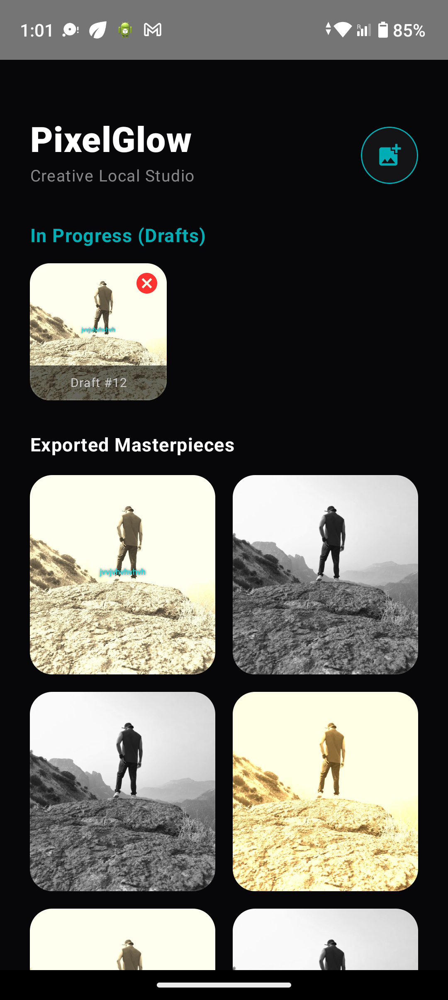
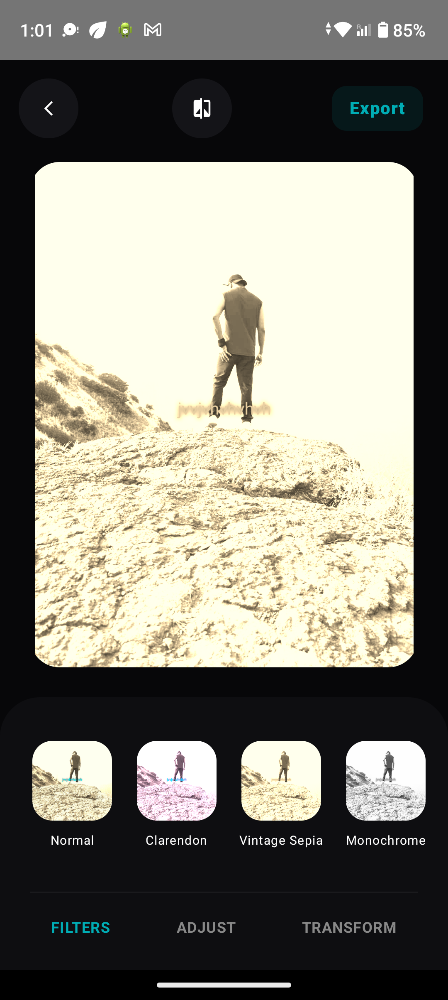

# 🌟 PixelGlow - Creative Studio Pro

PixelGlow is an enterprise-grade, high-performance Android Image Editor application built using **100% Native Jetpack Compose** and **Kotlin**. Engineered for the modern Android ecosystem (targeting Android 15/16), this application showcases state-of-the-art architectures, including local SQLite database caching, hardware-accelerated graphics manipulation, and smooth cinematic animations.

---

## 📱 App Screenshots

<div align="center">

| Studio Dashboard | Live Editor & Processing Studio |
| :---: | :---: |
|  |  |

</div>

---

## 🚀 Key Professional Features

### 🏛️ Architecture & Core Performance
* **16 KB Memory Page Size Support:** Fully compliant with the latest Google Play requirement for Android 15+ (API 35/36) 64-bit hardware alignment. Zero native crashes on future Android devices.
* **Modern MVVM Architecture:** Clean separation of concerns with unidirectional data flows (`StateFlow` & `SharedFlow`), ensuring robust, testable, and maintainable services.
* **Asynchronous Coroutines Layer:** Heavy image rendering and I/O tasks are offloaded to background threads using Kotlin Coroutines and `Dispatchers.IO` for a fluid 60 FPS UI experience.

### 🎨 Premium UI & Interactive Editing Studio
* **Premium Matte Dark UI Aesthetics:** A gorgeous Apple/Instagram-style design utilizing matte black shades and neon teal active glows.
* **Cinematic Filters Engine:** Production-ready color matrices rendering live pre-set variations (Clarendon, Vintage Sepia, Cinematic Teal) with smooth fading interpolation via Jetpack Compose graphics layer.
* **Draggable Neon Typography Overlays:** Responsive text injection engine with custom pointer input gestures, allowing real-time draggable neon subtitles that perma-print over underlying pixel arrays during export.
* **RGB Splitting Glitch & Color Leaks:** Cinematic 3D chromatic aberration matrices combined with radial/linear brush blend modes (`BlendMode.Multiply`, `BlendMode.Screen`) to simulate genuine film light-leaks.

### 💾 Smart Data Persistence & Scoped Storage
* **Room SQLite DB Drafts & Re-edit Engine:** Automatic workspace state capture. If a user drops an active editing session, the exact filter indexes, rotation offsets, and adjustment values are safely stored as an automated local draft on the dashboard for seamless future re-editing.
* **Automated Scoped Storage Integration:** Leverages modern `MediaStore API` with asynchronous `IS_PENDING` flags to export lossless JPEG binaries cleanly inside `Pictures/PixelGlow` folder without requiring legacy or dangerous runtime file permissions.
* **Draft CRUD Removal:** Integrated real-time local SQLite transactional queries to flush unwanted project rows instantly from the dashboard database.

---

## 🛠️ Tech Stack & Modern Tooling
* **Language:** 100% Kotlin (Modern Idiomatic Paradigms)
* **UI Framework:** Jetpack Compose (Declarative Components)
* **Image Loading:** Coil Compose (Asynchronous Memory-efficient Pipeline)
* **Database Engine:** Room Architecture Component (Local Caching)
* **Code Processing Compiler:** KSP (Kotlin Symbol Processing for optimal build speed)
* **Dependency Assembly:** Compose BOM (Bill of Materials) version verification

---

## 📂 Architecture Directory Structure

```text
com.portfolio.pixelglow/
│
├── data/
│   ├── local/              # Room Entity, DAO, AppDatabase Setup
│   ├── model/              # Matrix Filter Blueprints & Providers
│   └── ImageSaver.kt       # Scoped Storage Binary Compiler
│
├── ui/
│   ├── theme/              # Matte/Neon System Palettes & Typography
│   ├── viewmodel/          # Screen State Flows Navigation ViewModel
│   └── screens/            # Splash Screen & Layered Workspace UI Composables
│
└── MainActivity.kt         # Single Entry Architecture Point
```

---

## ⚙️ Configuration & Installation
To open and run this baseline repository safely on your local Android Studio workspace:
1. Ensure you have **Android Studio Ladybug (2024+)** or higher installed.
2. Clone the repository: `git clone https://github.com`
3. Select **Gradle Sync** to fetch and evaluate all required BOM modules.
4. Run the code on an Emulator running Android 15/16 or a physical test device.
